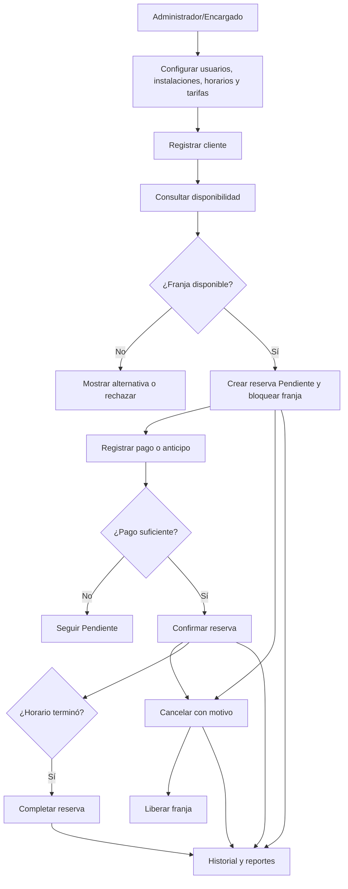
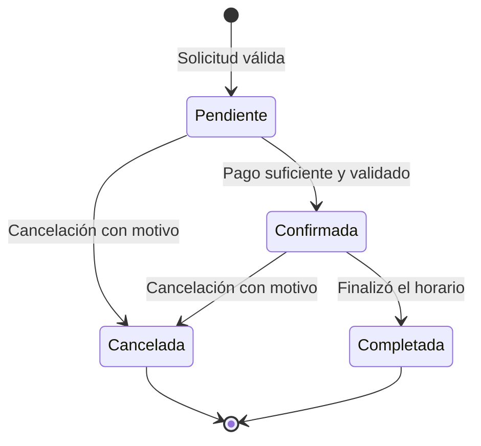
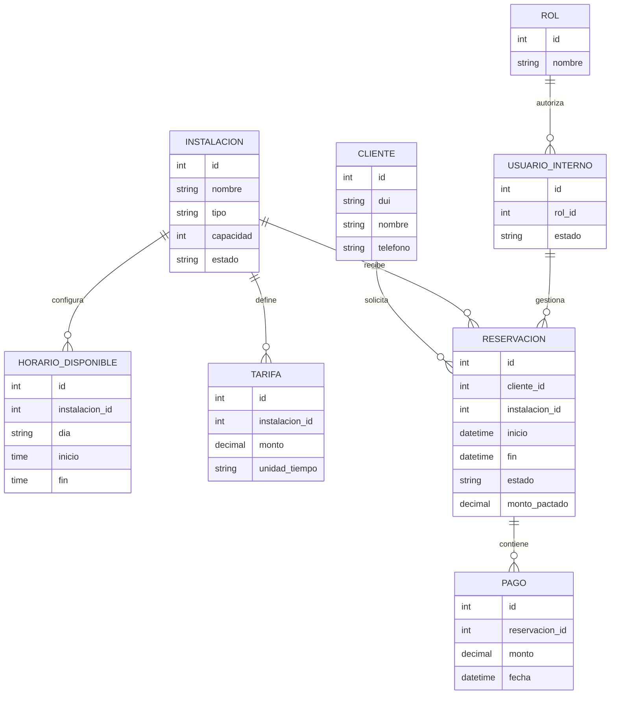
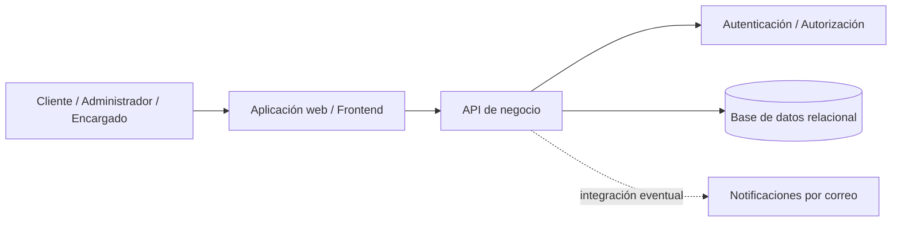
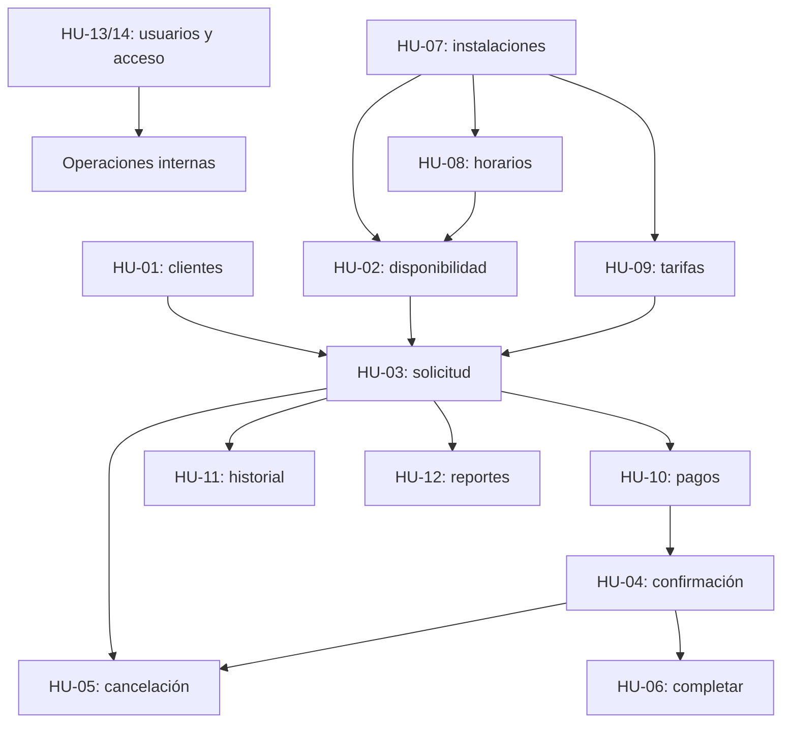

# SIRID — Documentación del proyecto

> **Fuente primaria:** Jira, proyecto [`SIRID`](https://ues-team-nfbnyzvr.atlassian.net/jira/software/projects/SIRID/boards/3/backlog), consultado el **11 de octubre de 2026**.  
> **Criterio de interpretación:** se distingue entre **hechos consignados en Jira**, **alcance inferido a partir de las historias** y **propuestas de implementación/documentación**. El estado «Listo» de Jira no constituye por sí solo evidencia de pruebas, despliegue o documentación adjunta.

## 1. Resumen ejecutivo

**SIRID** significa **Sistema de Reservación de Instalaciones Deportivas**. Su propósito es centralizar la administración de un complejo deportivo: usuarios internos, catálogo de instalaciones, horarios, tarifas, clientes, disponibilidad, ciclo de reservas, pagos y reportes. Se busca sustituir procesos fragmentados y evitar conflictos como la doble reserva de una misma instalación en un mismo horario.

La propuesta funcional se deduce de las historias registradas; no se ha auditado el repositorio de código ni un entorno desplegado.

**Datos confirmados en Jira:**

| Atributo | Valor |
|---|---|
| Clave y tablero | `SIRID`, tablero `3` |
| Líder del proyecto | José Eduardo Artiga Franco |
| Equipo registrado | Sergio David Hernández García, Karla Gissell Girón Martínez, Marcos Yahir Gallardo Cubas, José Eduardo Artiga Franco |
| Épicas | 5 |
| Historias de usuario | 14 |
| Total de incidencias | 19 (5 épicas + 14 historias) |
| Estimación total de historias | **61 SP** (Sprint 1: 29; Sprint 2: 32) |
| Estado de las historias | 7 «Listo» y 7 «Por hacer» |
| Adjuntos a historias | **0 en las 14 historias consultadas** el 11/10/2026 |

**Nota de alcance:** una referencia previa a «18 PBI» no coincide con el inventario actual de Jira: hay 14 historias y 5 épicas; revisar si los PBI adicionales existen fuera de este tablero o en otros documentos.

## 2. Problema que resuelve

Un centro deportivo necesita conocer qué instalaciones están operativas, a qué horas se pueden utilizar y cuánto cuesta cada franja. También requiere identificar al cliente, aceptar una solicitud solo cuando exista disponibilidad, confirmar cuando corresponda el pago, cancelarla liberando la franja y producir información administrativa. SIRID integra ese recorrido en un solo sistema.

### Objetivo general

Diseñar e implementar un sistema de gestión de instalaciones y reservaciones que preserve la integridad de los horarios, facilite la administración operativa y permita consultar el uso de las instalaciones.

### Objetivos específicos

- Gestionar usuarios internos y permisos de administrador/encargado.
- Mantener inventario de instalaciones, estados de operación, horarios y tarifas.
- Registrar clientes sin duplicación de DUI y consultar disponibilidad real.
- Administrar solicitudes y transiciones de estado de reservaciones.
- Registrar pagos/anticipos y verificar requisitos para confirmar.
- Presentar historiales y reportes según permisos.

## 3. Actores y responsabilidades funcionales

| Actor | Funcionalidad esperada (según HU) | Observación |
|---|---|---|
| Administrador | Gestión de usuarios, configuración y reportes | Permisos concretos deben validarse en el diseño de autorización |
| Encargado de reservaciones | Clientes, instalaciones, horarios, tarifas, pagos y estados de reserva | Las HU definen distintas operaciones de encargado |
| Cliente | Consultar disponibilidad, solicitar reserva y ver su historial | Falta decidir su modo de identificación/autenticación; la HU-13 se refiere expresamente a usuarios **internos** |

## 4. Módulos y trazabilidad de épicas

| Épica | Enfoque | Historias relacionadas | Puntos de historias |
|---|---|---|---:|
| [ÉPICA-01](https://ues-team-nfbnyzvr.atlassian.net/browse/SIRID-1) | Usuarios y autenticación | HU-13, HU-14 | 8 |
| [ÉPICA-02](https://ues-team-nfbnyzvr.atlassian.net/browse/SIRID-2) | Instalaciones, horarios y tarifas | HU-07, HU-08, HU-09 | 13 |
| [ÉPICA-03](https://ues-team-nfbnyzvr.atlassian.net/browse/SIRID-3) | Clientes, disponibilidad e historial | HU-01, HU-02, HU-11 | 11 |
| [ÉPICA-04](https://ues-team-nfbnyzvr.atlassian.net/browse/SIRID-4) | Reservaciones y pagos | HU-03, HU-04, HU-05, HU-06, HU-10 | 24 |
| [ÉPICA-05](https://ues-team-nfbnyzvr.atlassian.net/browse/SIRID-5) | Reportes y análisis | HU-12 | 5 |

Las cinco épicas están registradas en estado **«Por hacer»**, aun cuando sus historias del Sprint 1 estén marcadas «Listo». Conviene revisar el criterio de actualización de épicas.

## 5. Flujo funcional de extremo a extremo

**Importante:** el gráfico sintetiza HU de distintos sprints; no implica que todas las funciones estén desarrolladas.

## 6. Estados de reservación y reglas de negocio

Reglas imprescindibles derivadas de las historias:

1. No crear dos reservas que bloqueen el mismo intervalo de una misma instalación. La validación debe repetirse al **guardar** la reserva, idealmente dentro de una transacción, para cubrir concurrencia.
2. No ofrecer instalaciones «Fuera de servicio» y no permitir reservar fuera de horarios configurados.
3. Mantener tarifa vinculada a instalación y aplicar el monto actualizado a **nuevas** reservas; preservar el precio pactado de reservas existentes es una **propuesta** a validar.
4. Solo permitir `Pendiente → Confirmada` después de registrar un pago suficiente; el importe requerido y reglas de anticipos deben acordarse.
5. Solo permitir `Pendiente/Confirmada → Cancelada` con motivo; liberar la franja cancelada.
6. Solo permitir `Confirmada → Completada` cuando finalizó la franja.
7. Un cliente no debería leer las reservas de otro cliente (control de acceso recomendado).

## 7. Modelo de información conceptual (propuesta)

El ER es un **punto de partida para diseño**, no el esquema verificado de PostgreSQL ni del proyecto existente. Ajustar tipos, claves, relaciones y políticas de datos personales antes de implementar.

## 8. Arquitectura de referencia (por validar)

En el trabajo de diseño previo de SIRID se ha manejado **frontend Next.js, API FastAPI y base de datos PostgreSQL**, con posibles integraciones Google Identity y Gmail SMTP. **Jira no confirma el stack ni esas integraciones.** En particular, HU-13 especifica acceso con usuario y contraseña, de manera que Google Identity sería una decisión adicional, no un requisito probado.

Propuesta de organización de dominios: `identidad`, `instalaciones`, `horarios`, `tarifas`, `clientes`, `reservaciones`, `pagos`, `reportes`. Cada módulo debe definir contrato API, datos, validaciones, permisos y pruebas.

## 9. Plan de entregas y estado al 11/10/2026

| Sprint | Período fijado en Jira | Historias | Estimación | Estado de historias | Estado del sprint en Jira |
|---|---|---:|---:|---|---|
| [Sprint 1](https://ues-team-nfbnyzvr.atlassian.net/jira/software/projects/SIRID/boards/3/backlog) | 22 sep.–7 oct. 2026 | 7 | 29 SP | 7/7 «Listo» (100 %) | **Activo**, aunque su fecha final pasó |
| [Sprint 2](https://ues-team-nfbnyzvr.atlassian.net/jira/software/projects/SIRID/boards/3/backlog) | 8–22 oct. 2026 | 7 | 32 SP | 0/7 «Listo» (0 %) | **Futuro**, aunque su fecha inicial pasó |

No hay sprint 3 registrado en el tablero consultado. Los porcentajes describen **estados de Jira**, no el porcentaje de funcionalidad certificado mediante pruebas.

## 10. Dependencias principales

## 11. Reglas de calidad y definición de terminado (propuesta)

Una historia se considera verdaderamente entregable cuando se dispone de: código versionado; contrato y validaciones de API; cambios de esquema y migraciones; interfaz usable; pruebas de aceptación positivas y negativas; permisos; guía breve de ejecución; evidencia de pruebas; diagramas adecuados a su HU; referencia a commit o PR; demostración de funcionamiento; revisión del equipo; y estado Jira coherente. Ajustar esta definición a la rúbrica de DSI215 o del curso correspondiente.

**Criterios transversales recomendados:** validación backend, errores claros, contraseña hasheada y sesiones seguras, control de acceso, integridad referencial, protección de DUI y datos personales, prevención de doble reserva, consistencia temporal y no exponer información de otros clientes.

## 12. Riesgos, inconsistencias y decisiones pendientes

- **14 HU frente a «18 PBI» mencionado previamente:** confirmar el inventario definitivo y si faltan elementos en Jira.
- **Sin adjuntos en ninguna de las 14 historias** al momento de la consulta: hay que asociar UML, evidencias, scripts y documentación según correspondan. No significa que esos archivos no existan fuera de Jira.
- **Desalineación de sprints:** Sprint 1 continúa activo y Sprint 2 futuro a pesar de las fechas; corregir después de validar el proceso del equipo.
- **Criterio de pago:** definir saldo total vs anticipo aceptable; la HU-10 rechaza la confirmación cuando el importe registrado es insuficiente.
- **Acceso de clientes:** decidir si cliente se autentica, usa código de reserva o consulta con otra prueba de identidad.
- **Concurrencia:** definir restricciones reales de datos para evitar doble reserva simultánea.
- **Tarifas históricas y cancelaciones:** definir política de precio pactado, reembolso y auditoría.
- **Fechas/horarios:** fijar zona horaria y convención para intervalos contiguos.

## 13. Índice de documentación de esta entrega

- [`00_SIRID_VISION_GENERAL.md`](00_SIRID_VISION_GENERAL.md): presente documento.
- [`01_SIRID_SPRINT_1.md`](01_SIRID_SPRINT_1.md): historias, criterios, pruebas, evidencias y checklist de cierre del Sprint 1.
- [`02_SIRID_SPRINT_2.md`](02_SIRID_SPRINT_2.md): alcance de flujo de reservas, dependencias, historias, pruebas y checklist del Sprint 2.

## 14. Fuentes

- [Proyecto/tablero SIRID](https://ues-team-nfbnyzvr.atlassian.net/jira/software/projects/SIRID/boards/3/backlog)
- [Épicas 01–05](https://ues-team-nfbnyzvr.atlassian.net/browse/SIRID-1) (continuar con `SIRID-2` a `SIRID-5`).
- [Historias Sprint 1](https://ues-team-nfbnyzvr.atlassian.net/browse/SIRID-6) (rango `SIRID-6` a `SIRID-12`).
- [Historias Sprint 2](https://ues-team-nfbnyzvr.atlassian.net/browse/SIRID-13) (rango `SIRID-13` a `SIRID-19`).
