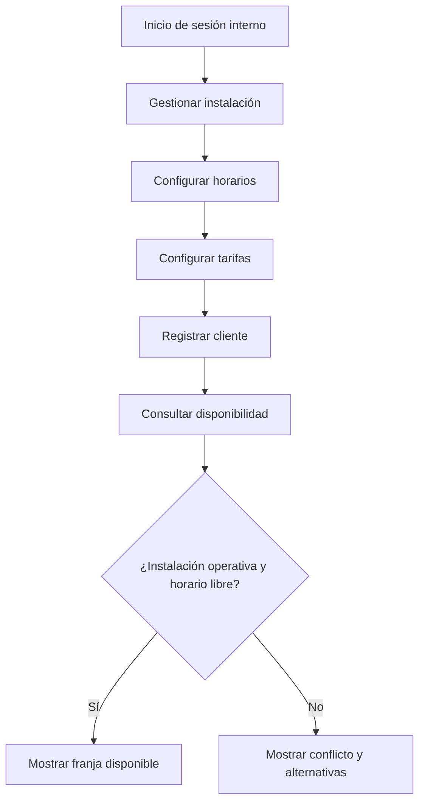

# SIRID — Sprint 1: fundamento operativo

> **Fuente:** [tablero SIRID](https://ues-team-nfbnyzvr.atlassian.net/jira/software/projects/SIRID/boards/3/backlog) y sus historias, consultado el **11/10/2026**. Las casillas de implementación/pruebas quedan vacías porque no se revisó código ni ejecución. El campo «Listo» es el estado declarado en Jira.

## 1. Objetivo y resultado esperado

El Sprint 1 establece la **base operativa** del sistema: acceso de usuarios internos, gestión de instalaciones/horarios/tarifas, registro de clientes y consulta de disponibilidad. Al finalizar, el equipo debe ser capaz de demostrar cómo un encargado prepara la oferta de instalaciones y cómo un cliente descubre si una franja está disponible, sin necesitar todavía el flujo completo de pago y confirmación.

**Período fijado en Jira:** 22/09/2026–07/10/2026. **Sprint ID:** 6. **Estado de Jira:** activo (aunque terminó la fecha planificada).

| Indicador | Valor |
|---|---:|
| Historias de usuario | 7 |
| Estimación total | **29 SP** |
| Historias en «Listo» | **7/7** |
| Historias con adjuntos en Jira | **0/7** |

## 2. Inventario del sprint

| Historia | Jira | Responsable | SP | Prioridad | Estado |
|---|---|---|---:|---|---|
| HU-14: Gestionar usuarios del sistema | [SIRID-6](https://ues-team-nfbnyzvr.atlassian.net/browse/SIRID-6) | Karla Gissell Girón Martínez | 5 | Media | Listo |
| HU-13: Iniciar sesión en el sistema | [SIRID-7](https://ues-team-nfbnyzvr.atlassian.net/browse/SIRID-7) | Marcos Yahir Gallardo Cubas | 3 | Alta | Listo |
| HU-07: Gestionar instalaciones deportivas | [SIRID-8](https://ues-team-nfbnyzvr.atlassian.net/browse/SIRID-8) | Sergio David Hernández García | 5 | Alta | Listo |
| HU-08: Configurar horarios disponibles | [SIRID-9](https://ues-team-nfbnyzvr.atlassian.net/browse/SIRID-9) | José Eduardo Artiga Franco | 5 | Alta | Listo |
| HU-09: Definir tarifas de instalaciones | [SIRID-10](https://ues-team-nfbnyzvr.atlassian.net/browse/SIRID-10) | Karla Gissell Girón Martínez | 3 | Media | Listo |
| HU-01: Registrar cliente | [SIRID-11](https://ues-team-nfbnyzvr.atlassian.net/browse/SIRID-11) | José Eduardo Artiga Franco | 3 | Alta | Listo |
| HU-02: Consultar disponibilidad de instalaciones | [SIRID-12](https://ues-team-nfbnyzvr.atlassian.net/browse/SIRID-12) | Sergio David Hernández García | 5 | Alta | Listo |

## 3. Detalle de historias, criterios y evidencias

Las secciones siguientes distinguen **criterios registrados en Jira** de **entregables y pruebas recomendados**. Los criterios se expresan en forma resumida manteniendo su significado.

### 1. HU-14 — Gestionar usuarios del sistema

**Jira:** [SIRID-6](https://ues-team-nfbnyzvr.atlassian.net/browse/SIRID-6) · **Épica:** ÉPICA-01 · **Responsable:** Karla Gissell Girón Martínez · **Prioridad:** Media · **Estimación:** 5 SP · **Vencimiento:** 2026-09-24 · **Estado registrado:** Listo.

**Historia:** Como administrador, quiero crear, actualizar y desactivar usuarios internos y asignarles roles, para controlar el acceso a las funciones del sistema.

**Criterios de aceptación de Jira (parafraseados fielmente):**
1. Registrar un usuario interno con rol permite iniciar sesión con los permisos correspondientes.
2. Desactivar un usuario interno impide su posterior inicio de sesión.

**Trabajo técnico que debería poder mostrarse en la entrega (propuesta):**

- [ ] Pantalla y API de alta, edición y desactivación de usuarios internos.
- [ ] Modelo persistente de usuarios/roles y validación de datos.
- [ ] Autorización por rol y bloqueo de cuentas desactivadas.
- [ ] Pruebas de acceso permitido/denegado y persistencia.

**Escenarios de prueba recomendados:**

- [ ] Alta con rol válido, autenticación y permisos correctos.
- [ ] Usuario desactivado no inicia sesión.
- [ ] Intento de asignar un rol no autorizado es rechazado.

**UML/evidencias recomendadas:** Casos de uso de administración de usuarios; Clases o ER de Usuario–Rol; Secuencia de crear/desactivar usuario. Adjuntar preferentemente en la propia historia Jira, además de guardar copia en repositorio/documentación.

### 2. HU-13 — Iniciar sesión en el sistema

**Jira:** [SIRID-7](https://ues-team-nfbnyzvr.atlassian.net/browse/SIRID-7) · **Épica:** ÉPICA-01 · **Responsable:** Marcos Yahir Gallardo Cubas · **Prioridad:** Alta · **Estimación:** 3 SP · **Vencimiento:** 2026-09-29 · **Estado registrado:** Listo.

**Historia:** Como usuario interno (encargado o administrador), quiero iniciar sesión con usuario y contraseña para acceder de forma segura al sistema.

**Criterios de aceptación de Jira (parafraseados fielmente):**
1. Con credenciales correctas se accede a las funciones del rol.
2. Credenciales incorrectas producen un mensaje genérico sin revelar cuál campo falló.
3. Un usuario desactivado no puede acceder.

**Trabajo técnico que debería poder mostrarse en la entrega (propuesta):**

- [ ] Formulario de inicio de sesión y gestión segura de sesión.
- [ ] Validación de credenciales en servidor y almacenamiento seguro de contraseñas.
- [ ] Protección de rutas/pantallas por rol.
- [ ] Manejo de mensajes de error y pruebas de acceso.

**Escenarios de prueba recomendados:**

- [ ] Inicio de sesión válido con cada rol.
- [ ] Contraseña equivocada no revela existencia de usuario.
- [ ] Cuenta desactivada bloqueada.
- [ ] Acceso no autenticado a ruta protegida denegado.

**UML/evidencias recomendadas:** Secuencia de autenticación; Actividad de login y errores; Casos de uso por actor. Adjuntar preferentemente en la propia historia Jira, además de guardar copia en repositorio/documentación.

### 3. HU-07 — Gestionar instalaciones deportivas

**Jira:** [SIRID-8](https://ues-team-nfbnyzvr.atlassian.net/browse/SIRID-8) · **Épica:** ÉPICA-02 · **Responsable:** Sergio David Hernández García · **Prioridad:** Alta · **Estimación:** 5 SP · **Vencimiento:** 2026-09-24 · **Estado registrado:** Listo.

**Historia:** Como encargado de reservaciones, quiero registrar, actualizar y desactivar instalaciones deportivas para mantener actualizada la oferta del complejo.

**Criterios de aceptación de Jira (parafraseados fielmente):**
1. Registrar nombre, tipo, capacidad y descripción deja la instalación disponible para reservar.
2. Una instalación marcada «Fuera de servicio» no puede reservarse.

**Trabajo técnico que debería poder mostrarse en la entrega (propuesta):**

- [ ] CRUD de instalaciones con formulario y listado.
- [ ] Campos nombre, tipo, capacidad, descripción y estado operativo.
- [ ] Validaciones y persistencia en base de datos.
- [ ] Regla de bloqueo de reservas para instalaciones fuera de servicio.

**Escenarios de prueba recomendados:**

- [ ] Crear instalación válida y verla disponible.
- [ ] Editar datos sin perder la identidad de la instalación.
- [ ] Marcar fuera de servicio y rechazar una nueva reserva.

**UML/evidencias recomendadas:** ER o clases de Instalación; Actividad de alta y desactivación; Secuencia de gestión de instalación. Adjuntar preferentemente en la propia historia Jira, además de guardar copia en repositorio/documentación.

### 4. HU-08 — Configurar horarios disponibles

**Jira:** [SIRID-9](https://ues-team-nfbnyzvr.atlassian.net/browse/SIRID-9) · **Épica:** ÉPICA-02 · **Responsable:** José Eduardo Artiga Franco · **Prioridad:** Alta · **Estimación:** 5 SP · **Vencimiento:** 2026-09-29 · **Estado registrado:** Listo.

**Historia:** Como encargado, quiero configurar horarios por instalación para indicar días y horas reservables.

**Criterios de aceptación de Jira (parafraseados fielmente):**
1. Guardar un rango horario lo hace disponible para futuras reservaciones.
2. Al intentar horarios superpuestos de una misma instalación, se presenta una advertencia.

**Trabajo técnico que debería poder mostrarse en la entrega (propuesta):**

- [ ] Interfaz para definir rangos horarios por instalación.
- [ ] Persistencia y validación de día, hora inicial y final.
- [ ] Detección de superposición dentro de la misma instalación.
- [ ] Pruebas con horarios contiguos, superpuestos y fuera de rango.

**Escenarios de prueba recomendados:**

- [ ] Guardar horario válido y consultarlo.
- [ ] Detectar solape de 10:00–12:00 con 11:00–13:00.
- [ ] Permitir dos rangos contiguos, si así se acordó en las reglas.

**UML/evidencias recomendadas:** Clases de Instalación–Horario; Actividad de configuración de horario; Secuencia de validación de solapes. Adjuntar preferentemente en la propia historia Jira, además de guardar copia en repositorio/documentación.

### 5. HU-09 — Definir tarifas de instalaciones

**Jira:** [SIRID-10](https://ues-team-nfbnyzvr.atlassian.net/browse/SIRID-10) · **Épica:** ÉPICA-02 · **Responsable:** Karla Gissell Girón Martínez · **Prioridad:** Media · **Estimación:** 3 SP · **Vencimiento:** 2026-09-29 · **Estado registrado:** Listo.

**Historia:** Como encargado, quiero definir y actualizar tarifas de instalaciones para calcular el precio de las reservas.

**Criterios de aceptación de Jira (parafraseados fielmente):**
1. Guardar monto y unidad de tiempo asocia la tarifa a su instalación.
2. Actualizar una tarifa hace que las nuevas reservaciones utilicen el nuevo monto.

**Trabajo técnico que debería poder mostrarse en la entrega (propuesta):**

- [ ] Formulario de tarifas y reglas de validación de montos y unidades.
- [ ] Asociación instalación–tarifa en datos y API.
- [ ] Cálculo de precio según duración y tarifa vigente.
- [ ] Pruebas de actualización de tarifa y nuevas solicitudes.

**Escenarios de prueba recomendados:**

- [ ] Asociar tarifa por hora a instalación.
- [ ] Modificar monto y comprobar su uso en nueva reserva.
- [ ] Rechazar tarifa negativa o unidad no admitida.

**UML/evidencias recomendadas:** ER Instalación–Tarifa; Secuencia de actualización de tarifa; Actividad de cálculo de costo. Adjuntar preferentemente en la propia historia Jira, además de guardar copia en repositorio/documentación.

### 6. HU-01 — Registrar cliente

**Jira:** [SIRID-11](https://ues-team-nfbnyzvr.atlassian.net/browse/SIRID-11) · **Épica:** ÉPICA-03 · **Responsable:** José Eduardo Artiga Franco · **Prioridad:** Alta · **Estimación:** 3 SP · **Vencimiento:** 2026-10-01 · **Estado registrado:** Listo.

**Historia:** Como encargado, quiero registrar datos de clientes para asociarlos a reservaciones.

**Criterios de aceptación de Jira (parafraseados fielmente):**
1. Registrar nombre, apellido, DUI y teléfono persiste el cliente.
2. Repetir un DUI registrado produce error y no crea un duplicado.

**Trabajo técnico que debería poder mostrarse en la entrega (propuesta):**

- [ ] Formulario y API de registro de clientes.
- [ ] Validaciones de campos obligatorios y formato acordado.
- [ ] Unicidad de DUI garantizada también en la base de datos.
- [ ] Pruebas de duplicados y consultas posteriores.

**Escenarios de prueba recomendados:**

- [ ] Registrar cliente completo y recuperarlo.
- [ ] Registrar mismo DUI dos veces y rechazar el segundo.
- [ ] Rechazar ausencia de campos obligatorios.

**UML/evidencias recomendadas:** ER Cliente; Secuencia de registro y verificación DUI; Actividad de validación de cliente. Adjuntar preferentemente en la propia historia Jira, además de guardar copia en repositorio/documentación.

### 7. HU-02 — Consultar disponibilidad de instalaciones

**Jira:** [SIRID-12](https://ues-team-nfbnyzvr.atlassian.net/browse/SIRID-12) · **Épica:** ÉPICA-03 · **Responsable:** Sergio David Hernández García · **Prioridad:** Alta · **Estimación:** 5 SP · **Vencimiento:** 2026-10-02 · **Estado registrado:** Listo.

**Historia:** Como cliente, quiero comprobar la disponibilidad de una instalación para una fecha y horario.

**Criterios de aceptación de Jira (parafraseados fielmente):**
1. Al indicar instalación, fecha y horas, el sistema informa si el intervalo está libre u ocupado.
2. Si está ocupado, sugiere horarios alternativos disponibles en el mismo día.

**Trabajo técnico que debería poder mostrarse en la entrega (propuesta):**

- [ ] Pantalla de búsqueda por instalación, fecha y rango.
- [ ] Consulta de horarios habilitados, estado operativo y reservas que bloquean franjas.
- [ ] Detección de cruces y propuesta de alternativas del mismo día.
- [ ] Pruebas de franjas libres, ocupadas, borde y sin alternativas.

**Escenarios de prueba recomendados:**

- [ ] Rango libre se indica disponible.
- [ ] Rango ocupado se indica no disponible y ofrece otra hora.
- [ ] Fuera de horario o instalación fuera de servicio se rechaza.
- [ ] Intervalos contiguos no se consideran solapados bajo la convención [inicio, fin).

**UML/evidencias recomendadas:** Secuencia de consulta de disponibilidad; Actividad de validación de conflictos; Modelo conceptual Horario–Reservación–Instalación. Adjuntar preferentemente en la propia historia Jira, además de guardar copia en repositorio/documentación.

## 4. Flujo integrador para la demostración

### Guion de demo propuesto

1. Ingresar como administrador; crear un usuario interno con rol y verificar sus permisos.
2. Intentar iniciar sesión con un usuario desactivado y comprobar bloqueo.
3. Crear instalación con nombre/tipo/capacidad/descripción; cambiarla a «Fuera de servicio» y comprobar su exclusión de reservas.
4. Crear rangos horarios y probar detección de solape.
5. Configurar tarifa por unidad temporal y modificar su monto.
6. Registrar un cliente y volver a intentar registrar su DUI: debe impedirse duplicado.
7. Consultar una franja libre y otra ocupada; mostrar alternativas disponibles en el mismo día.

## 5. Entregables mínimos esperados al cerrar Sprint 1

### 5.1 Funcionalidad

- [ ] Autenticación interna y control de usuarios/roles operativos (HU-13, HU-14).
- [ ] CRUD de instalaciones y bloqueo de estado «Fuera de servicio» (HU-07).
- [ ] Configuración persistente de franjas horarias sin solapes inadvertidos (HU-08).
- [ ] Tarifas ligadas a instalaciones y aplicables a nuevas solicitudes (HU-09).
- [ ] Registro de clientes con unicidad de DUI (HU-01).
- [ ] Consulta de disponibilidad y sugerencia de alternativas del mismo día (HU-02).

### 5.2 Código e infraestructura

- [ ] Repositorio con código de interfaz, API y persistencia.
- [ ] Migraciones/esquema para usuarios, roles, instalaciones, horarios, tarifas y clientes; contratos de reserva si la consulta los necesita.
- [ ] Archivo de configuración de entorno de ejemplo **sin secretos reales** y pasos de levantamiento.
- [ ] Datos semilla de instalaciones, clientes y horarios para demostrar casos.
- [ ] Validaciones en servidor y manejo uniforme de errores.
- [ ] Control de acceso y protección de datos personales.

### 5.3 UML, documentación y trazabilidad

- [ ] Diagrama general de casos de uso con actores.
- [ ] Diagrama de clases o entidad–relación consistente con la BD.
- [ ] Diagramas de actividades de autenticación, configuración y consulta de disponibilidad.
- [ ] Diagramas de secuencia de autenticación, configuración de horarios y consulta de disponibilidad.
- [ ] Tabla HU → pantalla → endpoint → entidad → prueba → diagrama.
- [ ] Diagramas **asociados a cada HU pertinente** en Jira (repetir un diagrama en distintas HU si es compartido).
- [ ] Evidencia gráfica o capturas de pruebas/demos para cada criterio.
- [ ] README con requisitos, configuración, credenciales de prueba ficticias y comandos de ejecución.

### 5.4 Validación y gestión

- [ ] Pruebas positivas y negativas de los criterios de las 7 HU.
- [ ] Demostración integral reproducible por otro integrante.
- [ ] Registro de defectos abiertos y decisiones de negocio pendientes.
- [ ] PR/commit o evidencia equivalente vinculado a cada HU.
- [ ] Revisión del equipo y validación de criterios de aceptación.
- [ ] Cierre formal del sprint en Jira, **solo cuando el equipo lo apruebe**.

## 6. Matriz sugerida de diagramas por historia

| Historia | Casos de uso | Actividad | Secuencia | Modelo estático |
|---|---|---|---|---|
| HU-14 Usuarios | Administración de usuarios | Alta/desactivación | Registro/desactivación | Usuario–Rol |
| HU-13 Login | Acceso interno | Validación de login | Autenticación | Usuario–Rol |
| HU-07 Instalaciones | Gestionar instalación | Alta/baja operativa | CRUD instalación | Instalación |
| HU-08 Horarios | Configurar horarios | Solapes | Validar rangos | Instalación–Horario |
| HU-09 Tarifas | Configurar tarifas | Cambio tarifa | Actualizar tarifa | Instalación–Tarifa |
| HU-01 Clientes | Registrar cliente | Validación de DUI | Alta cliente | Cliente |
| HU-02 Disponibilidad | Consultar disponibilidad | Libre/ocupado | Consulta y alternativas | Instalación–Horario–Reserva |

La matriz orienta la asignación; no significa que cada HU deba tener **cuatro diagramas separados**. Un mismo UML puede cubrir varias HU y adjuntarse a cada una, evitando crear documentos artificialmente duplicados.

## 7. Riesgos / brechas observadas

- Jira declara 7/7 historias «Listo», pero **ninguna de las siete tiene adjuntos** al corte consultado. No se comprobó código, pruebas o capturas.
- El Sprint 1 está marcado «Activo» pese a que su fecha de fin fue 7 de octubre.
- La consulta de disponibilidad requiere un criterio único de conflictos y de intervalos contiguos, que también debe usar HU-03 del Sprint 2.
- HU-13 distingue usuarios internos; la autenticación de clientes no está especificada de forma equivalente.

## 8. Criterio de salida sugerido

Se considera que el incremento está **demostrable** cuando se han verificado los criterios de aceptación de HU-01, 02, 07, 08, 09, 13 y 14, se ejecuta el flujo de demo completo, se dispone de modelo de datos y diagramas coherentes, se documenta cómo arrancar el sistema y cada HU posee su evidencia vinculada. El 100 % de estados «Listo» no sustituye estas comprobaciones.

**Fuente:** [Backlog SIRID](https://ues-team-nfbnyzvr.atlassian.net/jira/software/projects/SIRID/boards/3/backlog) · [Primera historia del Sprint 1](https://ues-team-nfbnyzvr.atlassian.net/browse/SIRID-6) · [Última historia del Sprint 1](https://ues-team-nfbnyzvr.atlassian.net/browse/SIRID-12).
