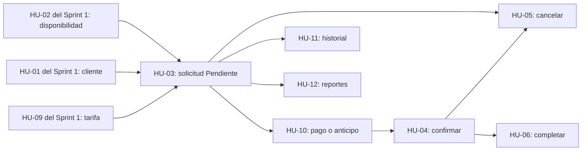

# SIRID — Sprint 2: ciclo de reservaciones y explotación de datos

> **Fuente:** [tablero SIRID](https://ues-team-nfbnyzvr.atlassian.net/jira/software/projects/SIRID/boards/3/backlog) y sus historias, consultado el **11/10/2026**. Las listas con casillas son entregables/pruebas **propuestos**, no avances certificados.

## 1. Objetivo del sprint

Completar el flujo que convierte una disponibilidad en una **reservación real**: solicitud, bloqueo de franja, pago/anticipo, confirmación, cancelación o finalización. Añadir el historial del cliente y los reportes administrativos. El incremento depende de instalaciones, tarifas, clientes y consulta de disponibilidad del Sprint 1.

**Período fijado en Jira:** 08/10/2026–22/10/2026. **Sprint ID:** 7. **Estado de Jira:** futuro, aunque su inicio planificado ya pasó.

| Indicador | Valor |
|---|---:|
| Historias | 7 |
| Estimación | **32 SP** |
| Historias «Listo» | 0/7 |
| Historias «Por hacer» | 7/7 |
| Historias con adjuntos | 0/7 |
| Incidencias señaladas como de riesgo por Jira | 2: SIRID-13 y SIRID-14 |

## 2. Inventario y responsables

| Historia | Jira | Responsable | SP | Prioridad | Fecha límite | Estado |
|---|---|---|---:|---|---|---|
| HU-03: Solicitar reservación | [SIRID-13](https://ues-team-nfbnyzvr.atlassian.net/browse/SIRID-13) | Marcos Yahir Gallardo Cubas | 8 | Alta | 2026-10-09 | Por hacer |
| HU-04: Confirmar reservación | [SIRID-14](https://ues-team-nfbnyzvr.atlassian.net/browse/SIRID-14) | José Eduardo Artiga Franco | 5 | Alta | 2026-10-16 | Por hacer |
| HU-05: Cancelar reservación | [SIRID-15](https://ues-team-nfbnyzvr.atlassian.net/browse/SIRID-15) | Sergio David Hernández García | 5 | Media | 2026-10-14 | Por hacer |
| HU-06: Completar reservación | [SIRID-16](https://ues-team-nfbnyzvr.atlassian.net/browse/SIRID-16) | José Eduardo Artiga Franco | 3 | Media | 2026-10-19 | Por hacer |
| HU-10: Registrar pago o anticipo | [SIRID-17](https://ues-team-nfbnyzvr.atlassian.net/browse/SIRID-17) | Karla Gissell Girón Martínez | 3 | Media | 2026-10-13 | Por hacer |
| HU-11: Consultar historial de reservaciones | [SIRID-18](https://ues-team-nfbnyzvr.atlassian.net/browse/SIRID-18) | Sergio David Hernández García | 3 | Baja | 2026-10-16 | Por hacer |
| HU-12: Generar reportes de reservaciones | [SIRID-19](https://ues-team-nfbnyzvr.atlassian.net/browse/SIRID-19) | Marcos Yahir Gallardo Cubas | 5 | Baja | 2026-10-20 | Por hacer |

## 3. Detalle de historias, criterios y evidencias

Los criterios se basan en la descripción de Jira; tareas, pruebas adicionales y UML constituyen una propuesta técnica.

### 1. HU-03 — Solicitar reservación

**Jira:** [SIRID-13](https://ues-team-nfbnyzvr.atlassian.net/browse/SIRID-13) · **Épica:** ÉPICA-04 · **Responsable:** Marcos Yahir Gallardo Cubas · **Prioridad:** Alta · **Estimación:** 8 SP · **Vencimiento:** 2026-10-09 · **Estado registrado:** Por hacer.

**Historia:** Como cliente, quiero solicitar una reservación de instalación deportiva para asegurar el uso en la fecha y hora requeridas.

**Criterios de aceptación de Jira (parafraseados fielmente):**
1. Si el período está disponible, crear la solicitud con estado «Pendiente».
2. Si el período está ocupado, rechazar solicitud informando no disponibilidad.
3. Tras crear solicitud, bloquear el mismo intervalo para otras solicitudes.

**Trabajo técnico que debería poder mostrarse en la entrega (propuesta):**

- [ ] Formulario de solicitud conectado a disponibilidad.
- [ ] API transaccional que compruebe disponibilidad al guardar, no solo al consultar.
- [ ] Persistencia de reserva Pendiente y bloqueo de horario.
- [ ] Pruebas concurrentes para impedir doble reserva.

**Escenarios de prueba recomendados:**

- [ ] Solicitud válida crea Pendiente y bloquea horario.
- [ ] Solicitud con conflicto devuelve error controlado.
- [ ] Dos solicitudes simultáneas al mismo intervalo no se confirman ambas.

**UML/evidencias recomendadas:** Secuencia de solicitar reserva y validar disponibilidad; Actividad de reserva exitosa/no disponible; ER Reservación–Cliente–Instalación. Adjuntar preferentemente en la propia historia Jira, además de guardar copia en repositorio/documentación.

### 2. HU-04 — Confirmar reservación

**Jira:** [SIRID-14](https://ues-team-nfbnyzvr.atlassian.net/browse/SIRID-14) · **Épica:** ÉPICA-04 · **Responsable:** José Eduardo Artiga Franco · **Prioridad:** Alta · **Estimación:** 5 SP · **Vencimiento:** 2026-10-16 · **Estado registrado:** Por hacer.

**Historia:** Como encargado, quiero confirmar una reservación pendiente tras validar el pago para formalizar su uso.

**Criterios de aceptación de Jira (parafraseados fielmente):**
1. Una reserva Pendiente con pago registrado pasa a «Confirmada».
2. Sin pago registrado, no se permite confirmar la reserva.

**Trabajo técnico que debería poder mostrarse en la entrega (propuesta):**

- [ ] Acción de confirmación restringida al rol correspondiente.
- [ ] Consulta de pagos registrados y regla de monto suficiente.
- [ ] Transición de estado controlada y registro de fecha/usuario de cambio (recomendado).
- [ ] Pruebas de pago completo, parcial e inexistente.

**Escenarios de prueba recomendados:**

- [ ] Pendiente con pago suficiente se confirma.
- [ ] Pendiente sin pago no se confirma.
- [ ] Pago insuficiente no confirma según HU-10.
- [ ] Reserva Cancelada o Completada no puede confirmarse por esta acción.

**UML/evidencias recomendadas:** Máquina de estados de Reservación; Secuencia de confirmar con validación de pago; Actividad de confirmación denegada. Adjuntar preferentemente en la propia historia Jira, además de guardar copia en repositorio/documentación.

### 3. HU-05 — Cancelar reservación

**Jira:** [SIRID-15](https://ues-team-nfbnyzvr.atlassian.net/browse/SIRID-15) · **Épica:** ÉPICA-04 · **Responsable:** Sergio David Hernández García · **Prioridad:** Media · **Estimación:** 5 SP · **Vencimiento:** 2026-10-14 · **Estado registrado:** Por hacer.

**Historia:** Como encargado, quiero cancelar una reservación para liberar la instalación si el cliente no podrá usarla.

**Criterios de aceptación de Jira (parafraseados fielmente):**
1. Una reserva Pendiente o Confirmada se cancela indicando un motivo y queda «Cancelada».
2. Al cancelarse, el horario asociado queda libre de nuevo.

**Trabajo técnico que debería poder mostrarse en la entrega (propuesta):**

- [ ] Acción de cancelación con motivo obligatorio.
- [ ] Validación de transición desde Pendiente o Confirmada.
- [ ] Actualización del estado y consulta de disponibilidad al cancelar.
- [ ] Pruebas de liberación y no cancelación de reservas completadas.

**Escenarios de prueba recomendados:**

- [ ] Cancelar Pendiente con motivo libera franja.
- [ ] Cancelar Confirmada con motivo libera franja.
- [ ] Sin motivo se rechaza.
- [ ] No se cancela una reserva Completada.

**UML/evidencias recomendadas:** Actividad de cancelar y liberar horario; Máquina de estados de Reservación; Secuencia de cancelación y disponibilidad. Adjuntar preferentemente en la propia historia Jira, además de guardar copia en repositorio/documentación.

### 4. HU-06 — Completar reservación

**Jira:** [SIRID-16](https://ues-team-nfbnyzvr.atlassian.net/browse/SIRID-16) · **Épica:** ÉPICA-04 · **Responsable:** José Eduardo Artiga Franco · **Prioridad:** Media · **Estimación:** 3 SP · **Vencimiento:** 2026-10-19 · **Estado registrado:** Por hacer.

**Historia:** Como encargado, quiero marcar una reservación como completada para controlar el uso real de las instalaciones.

**Criterios de aceptación de Jira (parafraseados fielmente):**
1. Una reserva Confirmada cuyo horario terminó cambia a «Completada».
2. Si el horario aún no termina, la operación es denegada.

**Trabajo técnico que debería poder mostrarse en la entrega (propuesta):**

- [ ] Acción restringida de finalizar/ completar.
- [ ] Validación de estado Confirmada y fin del intervalo frente a la hora del sistema.
- [ ] Persistencia y consulta del estado final.
- [ ] Pruebas antes, durante y después del horario de uso.

**Escenarios de prueba recomendados:**

- [ ] Confirmada con intervalo vencido pasa a Completada.
- [ ] Confirmada aún vigente no se completa.
- [ ] Pendiente o Cancelada no se completan.

**UML/evidencias recomendadas:** Máquina de estados de Reservación; Secuencia de completar; Actividad de validación temporal. Adjuntar preferentemente en la propia historia Jira, además de guardar copia en repositorio/documentación.

### 5. HU-10 — Registrar pago o anticipo

**Jira:** [SIRID-17](https://ues-team-nfbnyzvr.atlassian.net/browse/SIRID-17) · **Épica:** ÉPICA-04 · **Responsable:** Karla Gissell Girón Martínez · **Prioridad:** Media · **Estimación:** 3 SP · **Vencimiento:** 2026-10-13 · **Estado registrado:** Por hacer.

**Historia:** Como encargado, quiero registrar pagos y anticipos ligados a reservaciones para mantener control financiero.

**Criterios de aceptación de Jira (parafraseados fielmente):**
1. Un pago registrado queda vinculado a su reservación.
2. Si el pago acumulado no alcanza el monto requerido, confirmar la reserva informa pago insuficiente.

**Trabajo técnico que debería poder mostrarse en la entrega (propuesta):**

- [ ] Formulario/API de pago asociado a reserva y monto.
- [ ] Persistencia de pagos/anticipos y consulta de total pagado.
- [ ] Validación de montos y conexión de la regla con HU-04.
- [ ] Pruebas con anticipo parcial, pago completo y registro inválido.

**Escenarios de prueba recomendados:**

- [ ] Registrar anticipo y verificar asociación.
- [ ] Anticipo insuficiente bloquea confirmación.
- [ ] Pago suficiente permite evaluar confirmación.
- [ ] Monto cero o negativo rechazado.

**UML/evidencias recomendadas:** ER Reservación–Pago–Tarifa; Secuencia de registrar pago; Actividad de verificación de saldo. Adjuntar preferentemente en la propia historia Jira, además de guardar copia en repositorio/documentación.

### 6. HU-11 — Consultar historial de reservaciones

**Jira:** [SIRID-18](https://ues-team-nfbnyzvr.atlassian.net/browse/SIRID-18) · **Épica:** ÉPICA-03 · **Responsable:** Sergio David Hernández García · **Prioridad:** Baja · **Estimación:** 3 SP · **Vencimiento:** 2026-10-16 · **Estado registrado:** Por hacer.

**Historia:** Como cliente registrado, quiero ver el historial de mis reservas para conocer sus estados y fechas.

**Criterios de aceptación de Jira (parafraseados fielmente):**
1. El historial muestra todas las reservaciones del cliente ordenadas por fecha.
2. Cuando el cliente no tiene reservas, se muestra un mensaje explícito.

**Trabajo técnico que debería poder mostrarse en la entrega (propuesta):**

- [ ] Vista de historial por cliente con orden cronológico documentado.
- [ ] Consulta filtrada por identidad de cliente para evitar exposición de terceros.
- [ ] Mostrar fechas, instalación y estado por reserva.
- [ ] Pruebas con varias, cero y reservas de otros clientes.

**Escenarios de prueba recomendados:**

- [ ] Cliente con 2+ reservas ve solo las suyas, ordenadas.
- [ ] Cliente sin reservas ve estado vacío.
- [ ] Un cliente no obtiene historiales ajenos.

**UML/evidencias recomendadas:** Secuencia de consulta de historial; Casos de uso de cliente; Actividad de resultados/vacío. Adjuntar preferentemente en la propia historia Jira, además de guardar copia en repositorio/documentación.

### 7. HU-12 — Generar reportes de reservaciones

**Jira:** [SIRID-19](https://ues-team-nfbnyzvr.atlassian.net/browse/SIRID-19) · **Épica:** ÉPICA-05 · **Responsable:** Marcos Yahir Gallardo Cubas · **Prioridad:** Baja · **Estimación:** 5 SP · **Vencimiento:** 2026-10-20 · **Estado registrado:** Por hacer.

**Historia:** Como administrador, quiero generar reportes por período, instalación o estado para analizar uso del complejo deportivo.

**Criterios de aceptación de Jira (parafraseados fielmente):**
1. Seleccionar rango de fechas y filtros genera un resumen con la información solicitada.
2. Si no hay reservas que cumplan los filtros, el sistema informa que no hay resultados.

**Trabajo técnico que debería poder mostrarse en la entrega (propuesta):**

- [ ] Filtros por fecha, instalación y estado.
- [ ] Consultas agregadas coherentes con estados de reserva.
- [ ] Vista resumida del informe y caso sin resultados.
- [ ] Pruebas con registros de control y filtros combinados.

**Escenarios de prueba recomendados:**

- [ ] Filtro por rango produce recuentos correctos.
- [ ] Filtros combinados de instalación y estado respetados.
- [ ] Rango sin datos presenta mensaje vacío.

**UML/evidencias recomendadas:** Secuencia de generar reporte; Actividad de filtros y agregación; Modelo lógico de consulta de Reservación. Adjuntar preferentemente en la propia historia Jira, además de guardar copia en repositorio/documentación.

## 4. Secuencia de implementación recomendada

No conviene implementar por el orden numérico de Jira sin considerar dependencias:

1. **HU-03 (solicitar):** reutilizar HU-02 y crear reserva Pendiente con bloqueo atómico de la franja.
2. **HU-10 (registrar pago):** asociar pago/anticipo, calcular cuánto está abonado y verificar saldo.
3. **HU-04 (confirmar):** conectar el pago suficiente con la transición Pendiente → Confirmada.
4. **HU-05 (cancelar):** admitir Pendiente/Confirmada → Cancelada, guardar motivo y liberar franja.
5. **HU-06 (completar):** comprobar fin de uso antes de Confirmada → Completada.
6. **HU-11 (historial):** consultar exclusivamente las reservas del cliente. Puede desarrollarse en paralelo después de HU-03.
7. **HU-12 (reportes):** agregar estados por período e instalación. Puede iniciarse en paralelo, pero debe validarse con datos de todo el flujo.

## 5. Contratos y reglas críticas (propuesta técnica)

### 5.1 Reserva y disponibilidad consistente

- El servidor recibe `cliente_id`, `instalacion_id`, `inicio`, `fin` y verifica instalación operativa, franja habilitada, precio y conflictos.
- La creación de reserva y el bloqueo deben suceder de forma **atómica**. No basta con comprobar que la franja parecía libre en una pantalla anterior.
- Se recomienda considerar intervalos `[inicio, fin)` para permitir reservas contiguas sin solape; **validar esta política con el equipo**.
- Los estados que bloquean el horario deben quedar documentados. Según las HU, Pendiente y Confirmada bloquean; Cancelada libera. El tratamiento de Completada y expiración de Pendiente necesita especificación.

### 5.2 Pagos y transición de estado

- Cada pago debe apuntar a una reserva y registrar importe y fecha; método y comprobante son atributos útiles, pero no exigidos expresamente en Jira.
- HU-10 exige impedir la confirmación con importe insuficiente, mientras HU-04 exige pago registrado. Se propone resolver ambas reglas con una sola validación de **total abonado frente a importe exigido**.
- No definir «anticipo suficiente» arbitrariamente: acordar porcentaje/monto válido con el responsable funcional.
- El cambio de estado debe ser legal para evitar `Cancelada → Confirmada`, `Pendiente → Completada`, etc.

### 5.3 Historial y reportes

- El historial necesita vínculo inequívoco con el cliente y una forma segura de identificar a quién se muestran datos.
- El reporte mínimo aplica filtros por **fechas, instalación y estado**, incluye resultados resumidos y contempla cero resultados.
- Exportación a PDF/Excel, gráficos, notificaciones y reembolsos pueden ser ampliaciones; **no son criterios de aceptación confirmados** de estas siete HU.

## 6. Demostración integral de aceptación

1. Preparar una instalación activa, con horarios y tarifa, más un cliente registrado (entregables del Sprint 1).
2. Consultar una franja libre; solicitar reserva; verificar estado `Pendiente` y bloqueo de la franja.
3. Intentar reservar la misma franja desde otra operación/sesión: debe rechazarse.
4. Registrar anticipo menor al monto exigido; intentar confirmar: debe rechazarse.
5. Completar importe válido; confirmar: cambia a `Confirmada`.
6. Intentar completar antes del horario final: se rechaza; al finalizar puede completarse.
7. Crear otra reserva y cancelarla con motivo; comprobar franja liberada y nuevamente reservable.
8. Consultar historial propio y caso sin reservas.
9. Generar reporte por fechas, instalación, estado y filtros sin resultados.

## 7. Checklist de entrega al finalizar Sprint 2

### 7.1 Funcionalidad y reglas de negocio

- [ ] Creación de reserva Pendiente sin duplicación de franjas (HU-03).
- [ ] Registro persistente y trazable de pago/anticipo (HU-10).
- [ ] Confirmación solo ante pago suficiente y estado válido (HU-04).
- [ ] Cancelación con motivo y liberación automática de horario (HU-05).
- [ ] Finalización solo después de terminar la franja (HU-06).
- [ ] Historial del cliente correcto, privado y ordenado (HU-11).
- [ ] Reportes filtrables con totales correctos y estado vacío (HU-12).

### 7.2 Modelo de datos y API

- [ ] Entidades/migraciones para Reservación y Pago, con claves y restricciones.
- [ ] Política de conflictos de horario implementada de manera transaccional.
- [ ] Estados y transiciones documentadas, incluyendo tratamiento de Pendiente/Cancelada/Completada.
- [ ] Precio pactado/importe exigido, pagos parciales y total abonado modelados.
- [ ] Permisos por rol en operaciones internas y aislamiento de historial por cliente.
- [ ] Errores y validaciones del servidor demostrables.

### 7.3 Evidencia y UML

- [ ] Diagrama de **estados** de reservación validado.
- [ ] Diagrama de **actividades** del flujo completo.
- [ ] Secuencia de solicitud y bloqueo/concurrencia.
- [ ] Secuencia de pago y confirmación.
- [ ] Secuencia de cancelación/liberación y de cierre temporal.
- [ ] ER/clases actualizado con Reservación, Pago, Cliente, Instalación y Tarifa.
- [ ] Casos de uso e interfaz de historial/reportes.
- [ ] Matriz HU → componente → caso de prueba → evidencia → UML.
- [ ] Adjuntos de diagramas y capturas/pruebas en **cada historia Jira pertinente**, aun cuando varios reutilicen el mismo diagrama.

### 7.4 Pruebas, operación y gestión

- [ ] Pruebas unitarias de reglas de negocio, incluidas transiciones inválidas.
- [ ] Pruebas de integración para CRUD/reserva/pago/estado/reportes.
- [ ] Pruebas de concurrencia para evitar doble reserva.
- [ ] Pruebas de acceso: usuarios internos y aislamiento de datos de clientes.
- [ ] Dataset de demostración, script de arranque y manual de operación.
- [ ] Capturas, resultados de pruebas y enlaces a commits/PR por HU.
- [ ] Ejecución del guion de demo completo.
- [ ] Validación del responsable funcional y cierre del sprint cuando el equipo lo autorice.

## 8. Matriz UML sugerida por HU

| HU | Diagramas más pertinentes | Artefactos de prueba prioritarios |
|---|---|---|
| HU-03 Solicitar | Secuencia, actividad, ER | Reserva exitosa, no disponible y concurrencia |
| HU-04 Confirmar | Estados, secuencia | Pago suficiente/insuficiente |
| HU-05 Cancelar | Estados, actividad, secuencia | Motivo, liberar franja, estados inválidos |
| HU-06 Completar | Estados, actividad | Fin de horario y rechazo anticipado |
| HU-10 Pago | ER, secuencia | Pagos parciales y cálculo de saldo |
| HU-11 Historial | Casos de uso, secuencia | Orden, historial vacío y aislamiento |
| HU-12 Reportes | Actividad, secuencia | Filtros combinados, totales, cero resultados |

## 9. Riesgos actuales y prioridades de atención

- **SIRID-13 (HU-03)** venció el **09/10/2026**, permanece «Por hacer» y tiene prioridad alta. Es fundamental para casi todo Sprint 2.
- **SIRID-14 (HU-04)** tiene prioridad alta y depende de la validación de pagos (HU-10). Jira la señala como elemento en riesgo por prioridad.
- Los **7/7 elementos** constan «Por hacer», aun cuando el calendario de Sprint 2 inició el 8 de octubre; revisar la ejecución real con el equipo.
- No se encontraron **adjuntos en las siete historias**; los UML y las evidencias deberán enlazarse para una entrega documental completa.
- Acoplamientos más delicados: precio frente a anticipo; disponibilidad frente a bloqueo concurrente; cancelar frente a liberar; identidad de cliente frente a historial.

## 10. Criterio de salida sugerido

El sprint es demostrable cuando las siete HU satisfacen sus criterios, el flujo de punta a punta pasa tanto caminos exitosos como rechazados, no hay dobles reservas, el control financiero condiciona la confirmación, el historial y los reportes son consistentes, los diagramas y las pruebas están asociados a cada historia y puede ejecutarse una demo reproducible.

**Fuente:** [Backlog SIRID](https://ues-team-nfbnyzvr.atlassian.net/jira/software/projects/SIRID/boards/3/backlog) · [Primera historia del Sprint 2](https://ues-team-nfbnyzvr.atlassian.net/browse/SIRID-13) · [Última historia del Sprint 2](https://ues-team-nfbnyzvr.atlassian.net/browse/SIRID-19).
